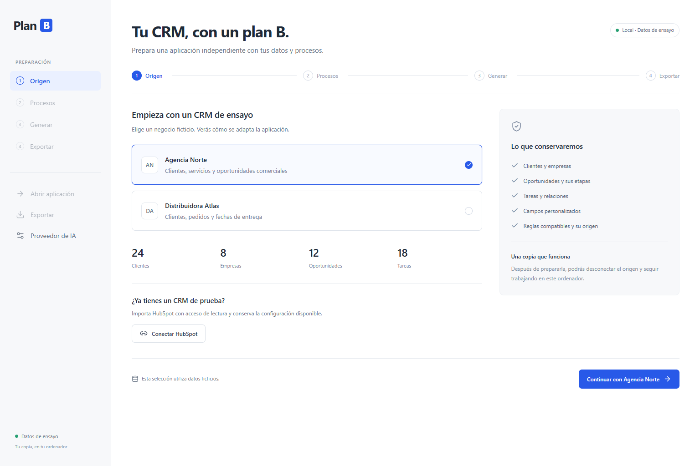
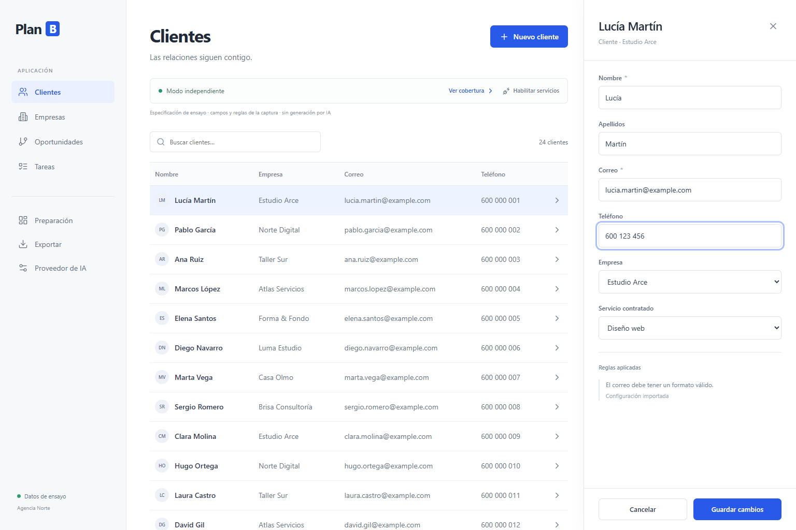
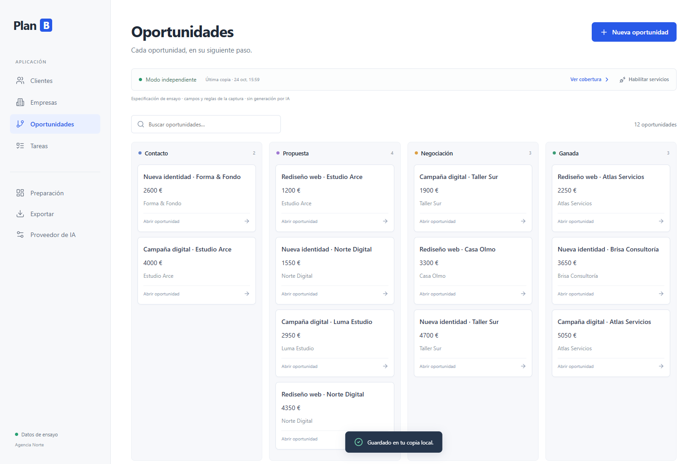
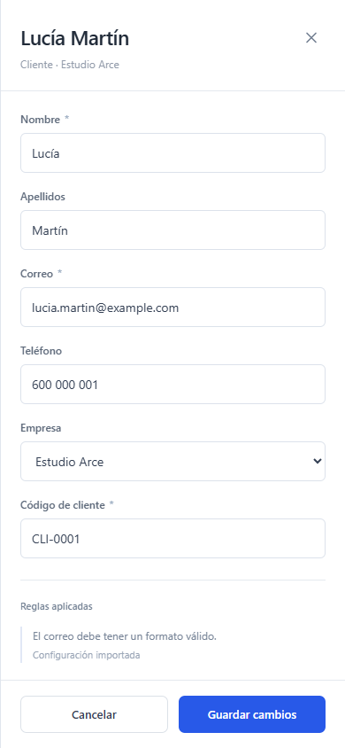

# Plan B CRM · Resultados de verificación

Fecha: 24 de octubre de 2026. Demostración local para un operador y datos ficticios.

## Resultado confirmado

- Compilación TypeScript, Vite y servidores: correcta.
- 19 pruebas automatizadas de lógica, API y conectores: correctas.
- 3 pruebas completas de navegador: correctas.
- Los dos ZIP extraídos, ejecutados sin claves, reiniciados y trasladados a otra carpeta: correctos.

La generación externa con el proveedor que el usuario añadirá después y la importación de una cuenta real de prueba de HubSpot no se han verificado. Las respuestas externas usadas en las pruebas de conectores son simulaciones controladas, claramente separadas de la especificación de ensayo de la interfaz. No se presenta una simulación como resultado de un proveedor real.

## Entorno

Windows, Node.js 24.19.0, React 19, TypeScript, Vite, Fastify y SQLite integrado en Node. Todos los recursos visuales se sirven localmente, sin fuentes ni bibliotecas desde CDN.

QA interactiva en el navegador integrado de Codex, http://127.0.0.1:4317. Automatización con Playwright y Edge, http://127.0.0.1:4337, 1536 × 1024 y 390 × 844. Browser plugin no disponible; se utilizaron CUA para la interacción integrada y Playwright para las pruebas automatizadas solicitadas en el plan.

## Navegador

Recorrido: Origen → Agencia Norte → captura conciliada → especificación de ensayo → revisión explícita → activar → desconectar → editar teléfono → avanzar oportunidad → crear tarea → recargar → comprobar cobertura → descargar CSV → abrir configuración de proveedor.

| Comprobación | Resultado | Evidencia |
| --- | --- | --- |
| Identidad de página | Correcto | Título Plan B · Tu CRM sigue contigo y URL local |
| Pantalla no vacía | Correcto | Asistente, tabla y formularios visibles |
| Sin pantalla de error de Vite/React | Correcto | Capturas y recorrido terminado |
| Consola | Correcto | Ningún error de página ni de consola durante el recorrido principal |
| Edición de cliente | Correcto | Teléfono 600 123 456 guardado y visible tras recargar |
| Avance de oportunidad | Correcto | Rediseño web · Estudio Arce aparece en Propuesta |
| Creación de tarea | Correcto | Llamar a Lucía sin conexión aparece tras guardar |
| Cobertura | Correcto | Seis comprobaciones locales verificadas después de desconectar |
| Descarga CSV | Correcto | ejemplo-cambios.csv contiene las tres modificaciones |
| Otro origen | Correcto | Distribuidora Atlas cambia campos, etapas y validación de referencia |
| Regla inválida en formulario | Correcto | En entrega sin referencia muestra error y no guarda |
| Móvil | Correcto | Edición y ajustes visibles, sin desbordamiento horizontal de página |

Se corrigieron durante QA los correos ficticios con apellidos acentuados, el desbordamiento causado por una etiqueta accesible fuera de la tabla y los selectores de las pruebas sobre campos obligatorios y listas. La validación del formulario y del servidor utiliza el mismo contrato.

## Datos y conciliación

Cada conjunto de ensayo contiene:

| Objeto | Esperado | Recuperado |
| --- | ---: | ---: |
| Clientes | 24 | 24 |
| Empresas | 8 | 8 |
| Oportunidades | 12 | 12 |
| Tareas | 18 | 18 |
| Total de registros | 62 | 62 |
| Relaciones | 84 | 84 |

Agencia Norte: Servicio contratado y etapas Contacto, Propuesta, Negociación, Ganada. Una propuesta exige servicio.

Distribuidora Atlas: Código de cliente obligatorio, Referencia del pedido y Fecha de entrega. Etapas Recibida, Validada, En entrega, Completada. La entrega exige referencia.

Los formularios, tablas y tablero se obtienen de la especificación declarativa; las pruebas cambian el origen sin editar código de interfaz.

## Lógica y conectores

Las pruebas verifican:

1. Dos capturas completas con configuraciones distintas.
2. Rechazo de capturas parciales y relaciones sin destino, conservando la última válida.
3. Rechazo de campos inventados, reglas incompatibles y procedencia sin evidencia.
4. Fallo de IA o regla inválida impide activar y editar.
5. Editar cliente, avanzar oportunidad y crear tarea; cerrar SQLite y abrirla conserva los tres cambios.
6. Trasladar un paquete de datos a otra carpeta conserva registros e historial.
7. Validación en servidor de correos, fechas imposibles, importes, opciones y referencias.
8. Protección frente a sustituir un origen con cambios locales sin confirmación.
9. Reserva de presupuesto previa a peticiones y conservación de reservas inciertas tras reiniciar.
10. API local, Host y Origin; exportaciones sin devolver claves.
11. Importador HubSpot con paginación, propiedades personalizadas y asociaciones mediante respuestas controladas.
12. Rechazo de cuentas de producción, IDs distintos, resultados parciales y cursores repetidos.
13. Adaptador de IA: destino explícito, credencial de ese destino, JSON Schema o JSON, solo metadatos.
14. Rechazo de contenido incompleto, JSON roto, especificación incompatible y saldo agotado.
15. Sin configuración, tarifas o conexión habilitada no se llama al proveedor.
16. La reserva de 25 USD bloquea la petición antes de enviarla.
17. La API pública oculta la clave y esta no se reutiliza para otra dirección.
18. El arnés de pruebas bloquea fetch y sockets externos antes de conectar.

El archivo pruebas-unitarias.txt contiene los 19 casos y sus resultados. pruebas-navegador.json contiene los tres casos de Playwright.

## Independencia y paquete

La prueba de navegador bloquea todas las solicitudes a destinos distintos de 127.0.0.1. El proceso Node se ejecuta con scripts/block-external.cjs, que bloquea fetch, DNS y sockets externos. Las tres operaciones usan únicamente el servidor local. No hubo solicitudes externas de la aplicación en el recorrido.

Este bloqueo se aplica a los procesos de prueba; no se ha modificado el firewall del ordenador. No se afirma haber realizado una desconexión física del equipo.

El servidor independiente se compila desde una entrada que no importa el generador, HubSpot ni el adaptador de IA. No registra rutas de generación o importación. El código del navegador contiene los componentes compartidos, pero oculta esas funciones en el modo independiente.

Se ejecutó scripts/verify-package.py sobre los dos ZIP terminados. Para cada uno se comprobó la integridad del archivo, se extrajo a una carpeta con espacios y se arrancó el node.exe incluido en el puerto 4347, sin credenciales del entorno y con el arnés de bloqueo externo. Se editó el teléfono de contact-1, se pasó deal-1 a proposal y se creó una tarea. Tras detener el proceso y mover la carpeta completa, un segundo arranque conservó los 63 registros y las tres operaciones del historial. El runtime devolvió 404 al intentar generar, como corresponde. Ambos terminaron sin intentos de conexión externa.

pruebas-paquetes.json contiene los resultados de ambos casos. La conciliación inicial mantiene 62 registros y 84 relaciones; el registro número 63 es la tarea creada durante cada prueba. La inspección del ZIP no encontró archivos privados de entorno, configuración de claves, bases SQLite de desarrollo ni claves OpenAI con formato real. La entrega final añade esta evidencia y comprueba otra vez la integridad, las entradas únicas y la identidad del servidor compilado.

## Fidelidad visual

Se compararon las capturas reales con los dos conceptos de referencia.

| Rasgo | Verificación / decisión |
| --- | --- |
| Blanco, texto oscuro, acento azul | Conservado |
| Barra lateral y marca Plan B | Conservadas; ancho unificado de 244 px en escritorio |
| Asistente de cuatro pasos | Conservado |
| Dos negocios y panel de conservación | Conservados |
| Tabla de clientes con fila seleccionada | Conservada; incluye el conjunto completo |
| Panel lateral y guardado inferior | Conservados, con desplazamiento propio |
| Reglas y procedencia visibles | Conservadas |
| Configuración de proveedor | Extensión funcional añadida por indicación del usuario |
| Móvil | Navegación superior y formulario de ancho completo |

El resultado adapta tamaños y densidad al producto funcional; no es una reproducción píxel a píxel del concepto. La revisión visual no detectó recortes en los formularios ni superposición de botones. Las tablas y el tablero se desplazan dentro de su contenedor en pantallas pequeñas.

Diferencias de texto revisadas: título, entidades y acción Nuevo cliente conservados. Se añadieron Proveedor de IA por petición del usuario, Especificación de ensayo para distinguir el modo sin modelo y Habilitar servicios para volver a importar o generar. El texto de origen se ajustó para identificar claramente los conjuntos ficticios. Son desviaciones funcionales deliberadas. La barra de fecha se oculta con el editor abierto para dejar espacio a los controles. Los conceptos están incluidos en source/design/prepare-concept.png y source/design/runtime-concept.png. Se inspeccionaron junto a las capturas reales con view_image a su relación de aspecto nativa.

## Reproducir

Desde el código fuente, con Node 24 y Edge instalado:

    npm ci
    npm test
    npm run build
    npm run test:e2e
    npm run package:demo
    python scripts/verify-package.py

Para la entrega se utilizó además scripts/prepare-deps.ps1 para incluir dependencias de producción, y una licencia oficial de Node. El ZIP lleva código fuente y archivos de bloqueo de versiones. No lleva .env.local, .ai.local.json, credenciales ni una base SQLite de desarrollo.

## Límites de la validación

Quedan pendientes una cuenta auténtica de prueba de HubSpot, la clave/modelo del proveedor que se configure más adelante, otros navegadores y sistemas operativos. El paquete Windows fue preparado con node.exe; no se ofrece como instalador para macOS o Linux. No se ha realizado una prueba de carga, auditoría exhaustiva ni validación para datos empresariales reales.

## Capturas

